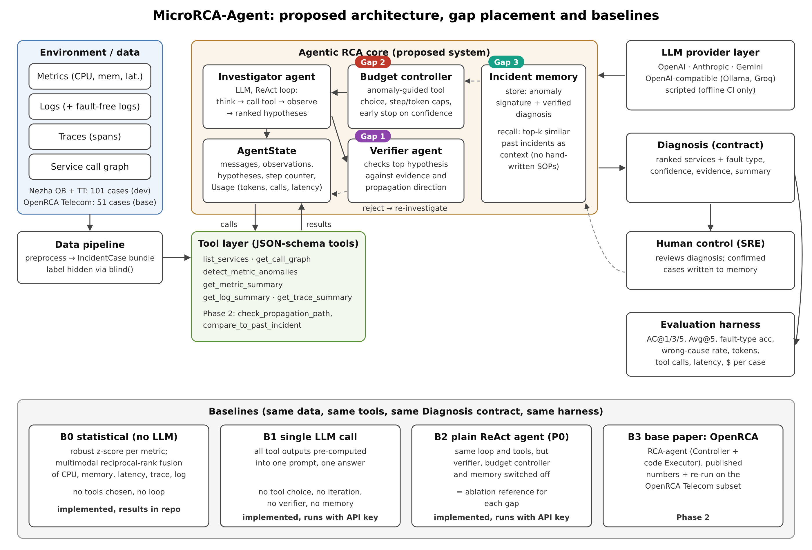

# Architecture

The diagram source is `architecture.svg`.

| Component | Code | Status |
|---|---|---|
| Data pipeline (Nezha → IncidentCase bundles) | `scripts/preprocess_nezha.py`, `src/microrca/data/store.py` | Done |
| Structured contracts | `src/microrca/contracts.py` | Done |
| Tool layer (6 tools + JSON schemas) | `src/microrca/tools/telemetry.py` | Done; propagation and memory tools in Phase 2 |
| LLM provider layer | `src/microrca/llm/providers.py` | Done |
| Investigator agent (ReAct loop, budgets, usage accounting) | `src/microrca/agent/react_agent.py` | Done |
| Verifier agent (Gap 1) | `verifier` hook in `react_agent.run` | Phase 2 |
| Budget controller (Gap 2) | `max_steps` / `max_tool_calls` + Usage | Caps done; adaptive policy in Phase 2 |
| Incident memory (Gap 3) | `Memory` protocol in `react_agent.py` | Phase 2 |
| Baselines B0, B1 | `src/microrca/baselines/` | Done |
| Evaluation harness | `src/microrca/eval/` | Done |
