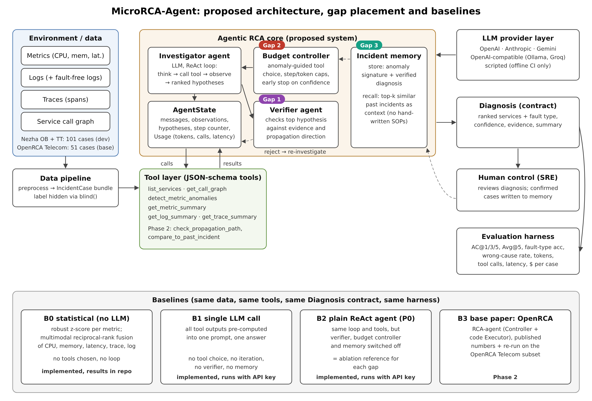
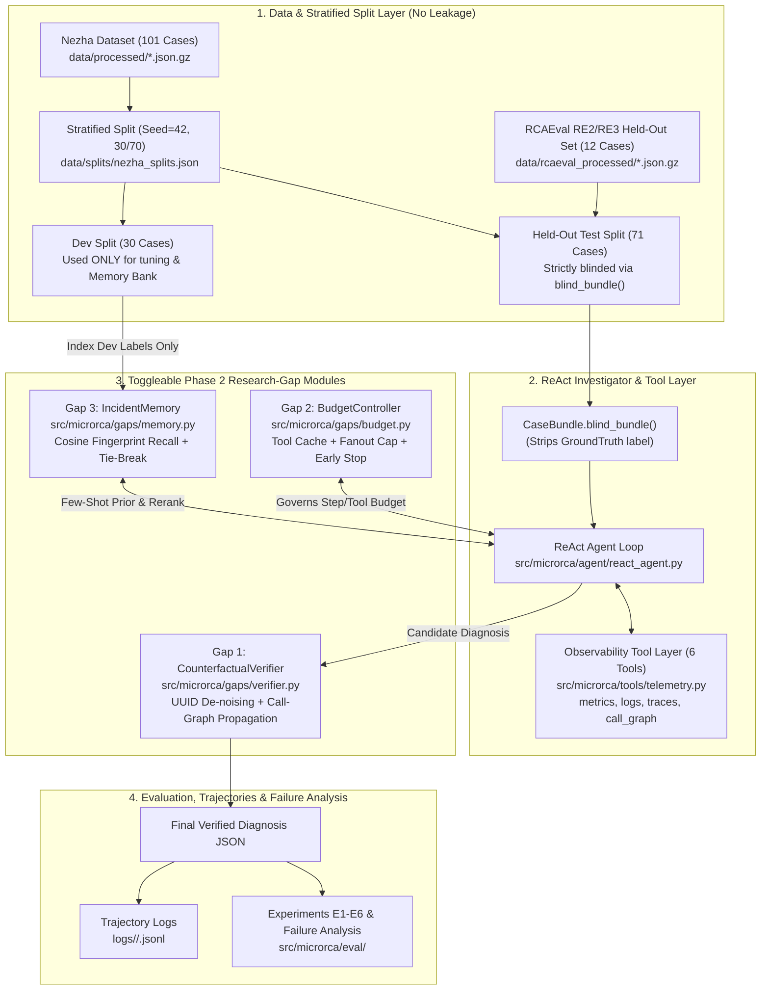

# MicroRCA-Agent Phase 2 Architecture

The static diagram source is `architecture.svg`. Below is the complete Phase 2 dataflow and component diagram showing how the stratified splits, observability tools, ReAct Investigator, and three toggleable Research Gap modules interact:

## Component Status (Phase 2)

| Component | Code | Owner | Status |
|---|---|---|---|
| Stratified Dev/Test Splits & RCAEval RE2/RE3 | `src/microrca/data/store.py`, `scripts/preprocess_rcaeval.py`, `data/splits/` | Syed Mustafa Ali | Done |
| Structured Contracts (Phase 2 extensions) | `src/microrca/contracts.py` | Syed Mustafa Ali | Done |
| Observability Tool Layer (6 tools + schemas) | `src/microrca/tools/telemetry.py` | Syed Mustafa Ali | Done |
| LLM Provider Layer (`.env`, retries, seeds) | `src/microrca/llm/providers.py` | Fasih Shahid Abbasi | Done |
| ReAct Investigator Agent + Trajectory Logger | `src/microrca/agent/react_agent.py` | Fasih Shahid Abbasi | Done |
| **Gap 1: Counterfactual Multi-Modal Verifier** | `src/microrca/gaps/verifier.py` | Ibrahim Umar Malik | Done (Dev-tuned) |
| **Gap 2: Adaptive Cost-Aware Budget Controller** | `src/microrca/gaps/budget.py` | Syed Mustafa Ali | Done (Dev-tuned) |
| **Gap 3: Leakage-Free Incident Memory** | `src/microrca/gaps/memory.py` | Fasih Shahid Abbasi | Done (Dev-only indexing) |
| Baselines (`B0`, `B1`, `E2-OpenRCA`) | `src/microrca/baselines/` | Ibrahim Umar Malik | Done |
| Experiments (`E1`–`E6`), Failure Analysis & Gap Table | `experiments/`, `src/microrca/eval/failures.py`, `src/microrca/eval/gap_table.py` | All Members | Done |
